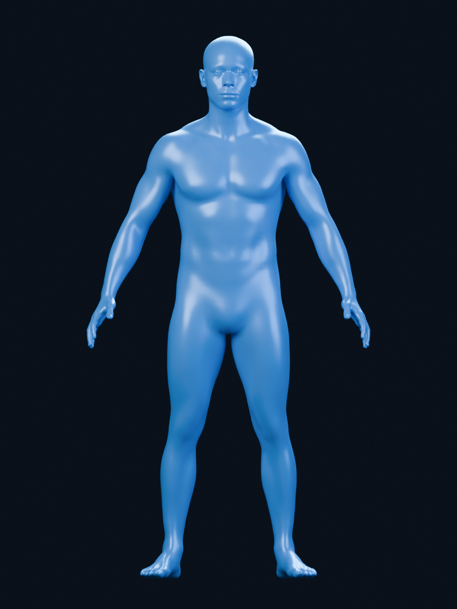
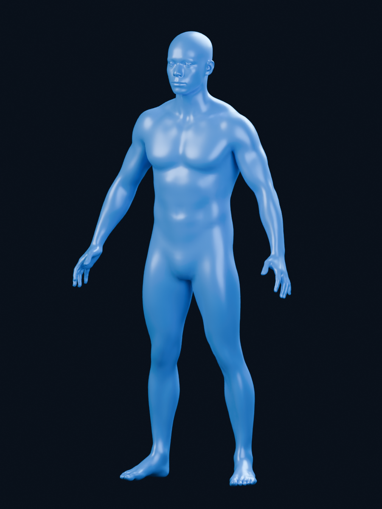

# 파란색 남성 HUD 인체 모델

Blender Studio의 **Human Base Meshes v1.4.1 / Body Male - Realistic**를 바탕으로 준비한 정적 인체 모델입니다.
스캔 기반 실사형 모델의 자연스러운 성인 남성 비례를 유지하고 파란색 재질을 적용했습니다.

[GLB 모델](hud_male_blue.glb) · [편집용 Blender 파일](hud_male_blue.blend)

 

- 원래 실사형 모델의 머리·몸통·팔다리 비례를 유지했습니다.
- 전신을 같은 비율로 확대해 높이를 1.80 m로 맞췄습니다. 머리나 다리만 따로 늘리지 않았습니다.
- 파란색 PBR 재질을 적용했습니다.
- GLB와 Blender 원본에는 인체 메시 3개만 포함됩니다. 미리보기용 카메라와 조명은 포함되지 않습니다.
- 움직임용 리깅, 내부 장기, 생체정보 연결은 포함되지 않습니다.

## 파일

- `hud_male_blue.glb`: 웹·실시간 3D 프로그램에 불러올 모델
- `hud_male_blue.blend`: 재질과 형태를 편집할 Blender 파일
- `preview_front.png`: 정면 렌더링
- `preview_three_quarter.png`: 사선 렌더링
- `asset_info.json`: 크기·메시 수·삼각형 수와 출처
- `build_hud_male.py`: 준비·내보내기·미리보기 생성 스크립트
- `verify_asset.py`, `verification.json`: GLB 재불러오기 검증 스크립트와 결과
- `fetch_source.py`: 공식 원본 ZIP을 내려받고 필요한 Blender 라이브러리를 추출하는 스크립트

GLB는 약 3.2 MB, 86,856개 삼각형으로 구성됩니다. 다시 불러온 모델의 메시 수, 유한 좌표, 크기, 삼각형 수를 검증했습니다.

## 재생성

Python 3와 Blender 4.2 이상이 필요합니다. 이 결과물은 Blender 5.2.3 LTS로 생성하고 검증했습니다.
이 폴더에서 다음 명령을 실행합니다. Blender 실행 파일이 PATH에 없으면 전체 경로를 사용합니다.

```powershell
python fetch_source.py
blender --background --factory-startup --disable-autoexec --threads 8 --python build_hud_male.py
blender --background --factory-startup --disable-autoexec --threads 8 --python verify_asset.py
```

`source/`의 공식 원본 ZIP과 추출한 라이브러리는 저장소에 포함하지 않습니다.
`fetch_source.py`가 버전이 고정된 공식 배포 파일을 받아 준비합니다.

## 출처와 라이선스

- 제작: Blender Studio 및 커뮤니티 기여자
- 원본 배포: [Blender Demo Files](https://www.blender.org/download/demo-files/)
- 원본 ZIP: [Human Base Meshes v1.4.1](https://mirror.blender.org/demo/asset-bundles/human-base-meshes/human-base-meshes-bundle-v1.4.1.zip)
- 실사형 남성 모델의 스캔 기반 교체 설명: [Blender 4.0 Asset Bundles](https://archive.blender.org/wiki/2024/wiki/Reference/Release_Notes/4.0/Asset_Bundles.html)
- 모델 라이선스: [CC0 1.0](https://creativecommons.org/publicdomain/zero/1.0/)

공식 배포 페이지의 해당 번들 CC0 표기를 확인했습니다. 준비한 파란색 메시 파일도 CC0로 제공합니다.
